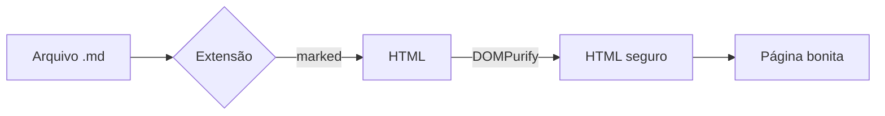

# Arquivo de teste do Viewer MD

Se você está vendo isto **formatado**, a extensão está funcionando. 🎉

## Texto

Parágrafo com *itálico*, **negrito**, ~~riscado~~, `código inline` e um [link externo](https://www.markdownguide.org).

> Isto é uma citação.
> Pode ter várias linhas.

## Listas

- Item 1
- Item 2
  - Subitem
- Item 3

1. Primeiro
2. Segundo

### Lista de tarefas

- [x] Criar a extensão
- [x] Carregar no Chrome
- [ ] Usar no dia a dia

## Tabela

| Recurso       | Suportado |
|---------------|:---------:|
| Títulos       | ✅        |
| Tabelas       | ✅        |
| Código        | ✅        |
| Tema escuro   | ✅        |

## Código

```javascript
function saudacao(nome) {
  return `Olá, ${nome}!`;
}
console.log(saudacao("mundo"));
```

```python
def soma(a, b):
    return a + b
```

## Diagrama (Mermaid)



---

Fim do arquivo.
